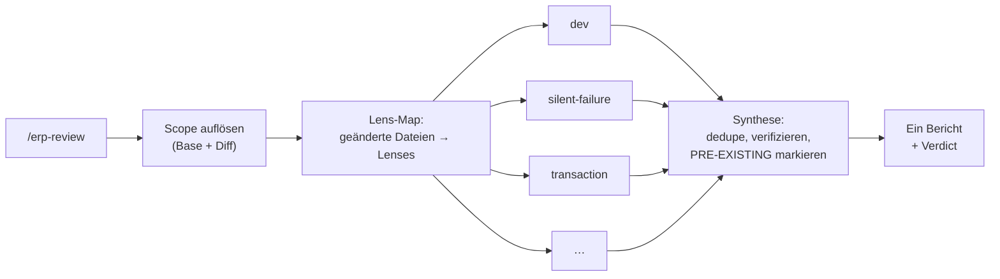

# Review-Agenten

Ein Review-Agent ist ein Subagent mit genau einer Aufgabe: einen Diff aus **einer** Perspektive prüfen. Er liest, er schreibt nicht. Er kennt die Regeln, die für seine Perspektive gelten, und er liefert seine Ergebnisse in einem festen Format ab. Mehr nicht.

Diese Perspektive nennen wir **Lens**. Statt eines Generalisten, der "mal drüberschaut", laufen mehrere spezialisierte Reviewer parallel, jeder mit eigener Lens, eigenem Modell und eigener Liste dessen, wonach er sucht.

## Warum Lenses statt eines Generalisten

Ein einzelner Reviewer mit dem Auftrag "prüf alles" prüft am Ende vor allem das Offensichtliche. Denn je breiter der Auftrag, desto dünner wird die Aufmerksamkeit pro Thema, und desto mehr Regeln muss er gleichzeitig im Kontext halten. Das Ergebnis sind generische Hinweise ("Lesbarkeit verbessern") statt konkreter Fehler.

Eine Lens dreht das um:

- **Enger Auftrag.** Der Silent-Failure-Reviewer sucht nach verschluckten Exceptions, sonst nichts. Er hat eine konkrete Jagdliste (`Hunt targets`) und weiß, wie die Fehler im Code aussehen.
- **Nur die relevanten Regeln.** Jeder Reviewer lädt die Regeln seiner Lens, nicht alle. Das spart Kontext und damit Tokens, und die Regel wird tatsächlich gelesen statt überflogen.
- **Passendes Modell.** Mustersuche (leere `catch`-Blöcke, falsches Log-Level) braucht kein großes Modell, dafür reicht Sonnet. Urteilsfragen (ist diese Transaktion zu breit? reicht der Call-Graph bis zu einem Socket?) bekommen Opus.
- **Nur was der Diff berührt.** Wer keinen Client-Code ändert, bekommt keinen Swing-Reviewer. Die Auswahl passiert automatisch anhand der geänderten Dateien.

Der Trade-off: mehrere Reviewer finden dieselbe Stelle doppelt, und jemand muss die Ergebnisse zusammenführen. Das übernimmt der Orchestrator (siehe unten). Perfekt wird die Abdeckung dadurch nicht, aber deutlich besser als mit einem Generalisten.

## Ablauf eines Reviews



Grob passiert folgendes (Details in [`../skills/erp-review/SKILL.md`](../skills/erp-review/SKILL.md)):

1. **Scope.** Der Skill legt fest, wogegen geprüft wird: offener MR, Staging-Area, Working Tree oder Branch gegen eine Base. Ohne eindeutige Base fragt er nach, statt zu raten.
2. **Lens-Auswahl.** Aus der Liste der geänderten Dateien wählt er über die [Lens-Map](_review-shared/lens-map.md) die Lenses aus. Eine Lens heißt ein Agent, ab zwei Lenses laufen die Agenten parallel.
3. **Review.** Jeder Agent liest den Diff, öffnet die betroffenen Dateien **in der geprüften Revision** vollständig, lädt seine Regeln und meldet Ergebnisse im gemeinsamen Format.
4. **Synthese.** Der Orchestrator führt alles zu einem Bericht zusammen: gleiche Stelle von zwei Reviewern wird ein Ergebnis mit der höheren Schwere, Ergebnisse ohne belegbare `file:line` fliegen raus oder werden heruntergestuft, bereits vorhandene Fehler werden als `[PRE-EXISTING]` markiert.
5. **Übergabe.** Der Bericht empfiehlt, er entscheidet nichts. Kein Edit, kein Commit, kein Push.

Wer die mechanischen Fixes direkt angewendet haben will, nimmt [`erp-review-loop`](../skills/erp-review-loop/SKILL.md). Der klassifiziert die Ergebnisse, wendet nur die rein mechanischen an, lässt die Tests laufen und wiederholt das bis zu einem sauberen Durchlauf. Alles, was Verhalten, Tests oder Design betrifft, bleibt beim Menschen.

## Die Lenses

Automatisch gewählt, abhängig von den geänderten Dateien:

| Lens | Worum es geht | Modell |
|---|---|---|
| `dev` | Grundlinie für jedes Java: Coding Style, Exceptions, Logging, i18n gegen die 2xx-Regeln | Sonnet |
| `silent-failure` | Fehler, die niemand bemerkt: verschluckte Exceptions, falsches Log-Level, Fallbacks, die einen Fehler wie ein leeres Ergebnis aussehen lassen, verlorene Stack Traces. In einem ERP wird aus so etwas eine falsche Rechnung. → [Agent](erp-silent-failure-reviewer.md) | Sonnet |
| `tester` | Tests und neue öffentliche Methoden: fehlt ein Test für riskante Logik, prüft der Test wirklich etwas (`assertTrue(true)`)? | Sonnet |
| `architect` | API-Modul, RPC-/REST-Verträge, neue Aggregates und Services: Schichtgrenzen, Vertragsform | Opus |
| `database` | Repositories, Entities, Queries, Fetch-Strategie, Migrationsskripte: Persistenzregeln, Idempotenz | Opus |
| `transaction` | Transaktionsgrenzen: so klein, kurz und spät wie möglich, kein I/O bei offener Transaktion, Proxy-Fallen in Spring, Lock-Eskalation in IRIS. → [Agent](erp-transaction-reviewer.md) | Opus |
| `swing-mvc` | Client-Code: Regeln des hauseigenen MVC-Frameworks (Lifecycle, Binding, Action-Wiring) | Sonnet |
| `docs` | Resource Bundles, `getText(`, Javadoc, Dokumentation, Regeldateien | Sonnet |

Nur auf Anforderung (`--lens`):

| Lens | Worum es geht | Modell |
|---|---|---|
| `performance` | N+1-Queries, Kandidaten für Projektionen, Algorithmen auf Hot Paths | Opus |
| `security` | Auth, Kryptografie, Eingaben, SQL, File-I/O, XML, ausgehende Verbindungen | Opus |
| `type-design` | `Long` als ID, Status als String, Boolean-Flags, die eigentlich ein Enum oder Record sein wollen | Sonnet |

Im Repo liegen zwei dieser Agenten als Beispiel. Die übrigen sind gleich aufgebaut.

### Zwei Beispiele im Detail

**`silent-failure`** ist der Typ "Mustersuche mit Kontext". Die Jagdliste ist konkret (leerer `catch`, `return null` im `catch`, `LOG.info` bei einer Runtime Exception, `e.getMessage()` statt `e` als letztes Logger-Argument). Trotzdem soll der Agent die Kandidaten vollständig lesen, denn ob ein Fallback gefährlich ist, entscheidet der Aufrufer, nicht die Zeile. Die schärfste Regel betrifft Bedarfspfade: dort muss ein Fehler "fail closed" sein, also im Zweifel bestellen statt überspringen. Ein "fail open" auf einem schreibenden Pfad ist ein `[BLOCKER]`.

**`transaction`** ist der Typ "Urteil, das kein Test leisten kann". Ein Architekturtest prüft bei uns, ob jeder Service seine Transaktionsgrenze **deklariert**. Ob diese Grenze auch eng ist und ob innerhalb der Transaktion transitiv ein REST-Call oder ein `Thread.sleep` passiert, ist statisch nicht entscheidbar. Genau das prüft der Agent: er verfolgt den Call bis zur Senke und zitiert die Kette (`A:line → B#method → openStream()`). Hintergrund ist der bewusst kleine Connection Pool auf IRIS: ein paar Threads, die mit offener Transaktion auf I/O warten, legen den Pool lahm. Der Agent ist ausdrücklich angehalten, abzuwägen statt pauschal zu verurteilen. Ein kurzes, begrenztes Warten in einem Retry ist ein Diskussionspunkt, kein Blocker.

## Der gemeinsame Vertrag

Alle Reviewer, auch der Cross-Vendor-Reviewer (GPT über Codex CLI), berichten nach [`_review-shared/severity-and-format.md`](_review-shared/severity-and-format.md). Nur so kann der Orchestrator die Ergebnisse vergleichen und zusammenführen.

**Schweregrade:**

- `[BLOCKER]`: Build kaputt, Daten falsch oder falsches Laufzeitverhalten.
- `[MAJOR]`: echte Fehler unterhalb davon, z.B. Schichtgrenze verletzt, fehlende i18n, neu eingeführtes N+1, fehlender Test für riskante Logik.
- `[MINOR]`: Naming, toter Code, Stil.
- `[PRE-EXISTING]`: Fehler, der schon vorher da war. Wird gemeldet, damit er nicht verloren geht, zählt aber nicht ins Verdict.

**Eine Zeile pro Ergebnis**, mit Stelle, Begründung, konkretem Fix und der verletzten Regel:

```
- [MAJOR] path/OrderService.java:88 — exception logged via e.getMessage(), stack trace lost — fix: pass e as last argument [rule: 213-logging]
Verdict: 0 blocker / 1 major / 2 minor (+1 pre-existing)
```

**Verifizieren vor dem Melden.** Das ist der wichtigste Teil des Vertrags und der, an dem Review-Agenten am häufigsten scheitern. Ein Ergebnis braucht eine `file:line`, die der Agent tatsächlich geöffnet hat, nicht eine Vermutung aus einem Methodennamen. Und eine korrekte Stelle reicht nicht, die Begründung muss ebenfalls halten. Drei Ergebnisse, die zwar die richtige Zeile hatten, aber eine falsche Prämisse, wurden umgesetzt und danach wieder zurückgedreht. Ein falsches Ergebnis ist teurer als ein übersehener Nit, und am teuersten ist es, sobald jemand danach handelt.

Dasselbe gilt für den Fix: entweder es gibt im Repo einen Präzedenzfall, der zeigt, dass er funktioniert, oder er wird als `fix (unverified)` markiert.

## Was die Agenten nicht tun

- Sie editieren nicht, committen nicht, pushen nicht.
- Sie rufen keine weiteren Subagenten auf.
- Sie gaten nichts. Der Bericht ist eine Empfehlung, die Entscheidung trifft der Entwickler.
