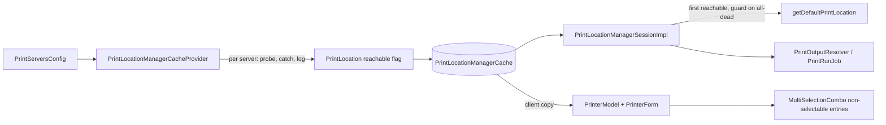

# Fault-tolerant Druckorte (variant D)

<!-- flow-next spec, neutralized: tracker keys, person names, merge-request numbers, fix versions and product-internal class prefixes removed or generalized. German domain terms are kept on purpose (codebase contract). -->

## Goal & Context

Today one unreachable print server empties the whole Druckort cache: `PrintLocationManagerCacheProvider` throws on the first server that does not answer, so no Druckort of any server is available. This blocks the shared base print dialog and with it practically every print path (Kaufvertrag, Angebot, Etikettenpool, Formbriefe, Listen/Controllingcenter, Druckcenter). On a warm cache the failed reload keeps the old value, so dead printers stay listed and new ones never appear. And an unknown Druckort key silently falls back to the first Druckort of the list: Filiale A prints in Filiale B.

Target (variant D, decided by product management in the story): every configured Druckort stays in the cache; an unreachable one carries an empty printer list and a state flag, is visible and blocked in the selection, and a print never lands on a foreign printer. Total outage keeps today's user message; only a partial outage becomes tolerant (difference: an all-dead load is now cached until the next timed evict, see Edge Cases).

Tracker: one epic with a core story, a test story, an i18n story and a docs story. Base: `master`. Intervention in the base print stack, not the Druckcenter — review weight accordingly.

Affected: Swing users in the shared print dialog (output page Drucker), Druckcenter release and runs, server code calling the default Druckort, operators (log lines per dead server).

## Architecture & Data Models



Ownership:
- `PrintLocation` (erp-api, Serializable, shared server/client) owns `reachable` (boolean, default `true`). Only the cache provider sets it to `false`. Existing creation sites stay valid unchanged.
- The cache provider owns probing; name, key, hostname and `PrintServerConfig` of an unreachable Druckort come from configuration, never from the server.
- `PrintLocationManagerSessionImpl` owns the default rule and the central guard.
- `MultiSelectionCombo` owns the generic "entry not selectable" capability; `PrinterModel` owns which Druckort is not selectable.

## API Contracts

- `PrintLocation#isReachable()` / `setReachable(boolean)`; default `true`; part of the serialized form.
- `PrintLocationManagerSession#getDefaultPrintLocation()` (server impl): first reachable Druckort; `null` when no Druckort is configured (unchanged); throws the central guard exception when Druckorte are configured but none is reachable.
- `MultiSelectionCombo`: opt-in way to declare entries non-selectable (predicate-style); combos that do not opt in behave exactly as before.

## Edge Cases & Constraints

- `getPrintLocation(key)` with a known key returns that Druckort even when unreachable (no substitution by another server). Blank or unknown key keeps falling back to the default rule, so under total outage it now throws the guard instead of returning a dead Druckort.
- `PrintLocation` has no `equals/hashCode`; anything comparing Druckorte across cache reloads must compare by key.
- Mockito `mock(PrintLocation.class)` returns `false` for `isReachable()`; existing mock-based tests must stub it or use real instances.
- EDI positions and `withoutOutput` runs are dispatched without a Druckort and must not hit the reachability check.
- Recovery after an outage relies on the existing 10-minute timed evict or `refreshPrintLocations()`; the warm job treats a tolerant load as loaded. This also applies to a load where every server is dead (today such a cold load is not cached and the next access retries) and replaces the keep-last-value path for this cache. Accepted, not changed.
- Ausführungspläne release via the same output ladder as interactive releases; their refusal classification decides between "plan stays active" and "plan deactivated". An unreachable Druckort is a transient condition there.
- Cold build still probes servers sequentially, each up to the 2-minute read timeout of the spool client. Not changed here (separate ticket).
- `PrintServersConfig` still drops servers with missing credentials or invalid URL (logged); they never become Druckorte.
- Client default Druckort is always the local workstation; the server default rule does not apply there.
- The E-Post form shows no Druckort widget and E-Post is being retired: E-Post gets a model-level guard only.

## Acceptance Criteria

- **R1:** Loading the Druckort cache never aborts because of one server: every Druckort from `PrintServersConfig` is in the cache; a server that fails the probe yields a Druckort with name, key, hostname and config from configuration, an empty printer list, no default printer and `reachable = false`; each failure is logged once per load with server name and root cause. Errors: all servers unreachable → cache still loads with all Druckorte flagged (R3 handles it); invalid configs are dropped as today.
- **R2:** `PrintLocation` carries `reachable`, default `true`, carried in the server → client cache copy (client and server ship together; no cross-version stream compatibility is claimed or needed). Errors: an instance created by any existing creation site is reachable without code change there.
- **R3:** Server `getDefaultPrintLocation()` returns the first reachable Druckort in configuration order; with none configured it returns `null` as today; with Druckorte configured and none reachable it throws an exception carrying today's user sentence ("Der Printserver … ist nicht erreichbar …") from an i18n key, via one central guard modelled on the existing default-printer check. `getPrintLocation(key)` for a known key returns that Druckort regardless of reachability. Errors: blank/unknown key under total outage → the guard exception, never a dead or foreign Druckort.
- **R4:** In the shared print dialog (output page Drucker) an unreachable Druckort is listed, visibly marked and cannot be selected by the user; its printer list is empty. A stored selection that points to an unreachable Druckort is not silently replaced by another Druckort: it stays shown as blocked and printing is not possible until the user picks a reachable Druckort (the output page reports itself invalid, so the dialog's finish action is disabled). Without a stored selection the preselection is the first reachable remote Druckort. Errors: no remote Druckort at all → no crash (today `IndexOutOfBounds`); all remote unreachable → nothing preselected, printing blocked.
- **R5:** `MultiSelectionCombo` supports non-selectable entries as an opt-in: such entries render disabled and cannot be chosen by mouse or keyboard; a value set by binding/model is kept and displayed. Errors: combos that do not opt in render and select exactly as before (empty-entry rendering included).
- **R6:** Druckcenter: a release whose Druckort is unreachable is refused with a dedicated "Druckort nicht erreichbar" reason, checked before the printer check (no "kein Drucker ermittelt"). A run whose Druckort exists but is unreachable starts; for each Beleg only the Ausgabeart that needs the Druckort (Drucker) fails with the dedicated unreachable reason, while its other Ausgabearten (E-Mail, Archiv, …) go out (no run abort, no substitution). An Ausführungsplan whose Druckort is unreachable at its slot is refused transiently: the plan stays active and retries at the next slot, it is never deactivated for this reason. Errors: Druckort deleted from configuration → existing `printLocationGone` abort unchanged; guard exception under total outage → handled as a technical abort with a reason, never an uncaught exception; EDI and without-output paths unaffected.
- **R7:** All new texts are structured keys, German only in `print.properties` (and the client bundle used by the dialog), empty values in the en/fr/nl/zh siblings, no concatenation; committed under the i18n story. The hardcoded provider sentence is replaced by a key.
- **R8:** Documentation reflects the behaviour: `DOM-print-center` (refusal/abort tables), `DOC-print-framework` (PrintLocation, cache, default rule) and the release-gate smoke list (scenario "Printserver gestoppt"); committed under the docs story.

## Early proof point

Task `.2` validates the core approach (a tolerant provider builds a full cache from configuration with one dead server, proven by a provider unit test with a faked spool client). If the provider cannot be tested without a seam that changes its structure noticeably, re-evaluate the probe extraction before `.3`+.

## Boundaries

- Legacy print paths stay untouched: session manager, print transaction, the static print utilities' callers, the execution timer job, batch print output, the legacy print manager (they benefit via R3).
- Deliberate exceptions, added after the plan (story follow-up, MR review): `OutputManagerSessionImpl#createOutput` preselects a new printer output on the first configured Druckort during a total outage instead of throwing the guard, so the print dialog opens and the user can switch to an output without print server; `PrinterOutputManager#print` refuses an unreachable Druckort with the guard's user sentence before the spool call. The guard itself lives in erp-impl (`PrintLocationReachability`), and the Druckcenter looks up its Druckort through the exact, non-throwing `PrintLocationManagerSession#findPrintLocation`.
- Health indicators unchanged (the print-server health indicator already reports dead servers).
- No parallel probing, no timeout or TTL change, no keep-last-value special case for a dead Druckort (it is blocked anyway).
- No E-Post UI; no REST exposure of `reachable`.
- Not the deleted-from-configuration case beyond today's handling.

## Decision Context

- Variant D over A/B/C (story): A/B drop the Druckort and let the key fallback print on a foreign server; C keeps the total outage.
- Combo blocking generic in `MultiSelectionCombo` (user decision) rather than a local veto in `PrinterModel`: reusable, accepted client-wide regression risk, mitigated by opt-in.
- Run behaviour per Beleg (user decision) rather than one run abort: matches "gespeicherte Ausgaben laufen auf und scheitern mit Meldung"; a transient outage does not kill the run.
- Dedicated message keys (user decision) rather than reusing "existiert nicht mehr"/"kein Drucker".
- One delivery (no release between tolerant provider and default fix: tolerant provider alone yields NPEs instead of an outage).

## Quick commands

```bash
TZ=Europe/Berlin mvn -pl :erp-impl test -Dtest='PrintLocationManagerCacheProviderTest,PrintLocationManagerSessionImplTest,PrintOutputResolverTest,PrintRunJobFaultSplitTest'
TZ=Europe/Berlin xvfb-run -a mvn -pl :erp-client test -Dtest='MultiSelectionCombo*Test,PrinterModel*Test'
```

## References

- Tracker: epic, core story (decision comments), findings ticket, read-timeout ticket, cold-load ticket, keep-last-value ticket (keys removed)
- Overlap (no dependency): three other open specs touch `PrintOutputResolver`, `PrintRunPositionExecutor`, `print.properties`

## Requirement coverage

| R-ID | Tasks |
|------|-------|
| R1 | .2 |
| R2 | .2 |
| R3 | .3 |
| R4 | .6 |
| R5 | .5 |
| R6 | .4 |
| R7 | .1 |
| R8 | .7 |

Task list (titles only in this excerpt; `.2` and `.4` are included in full under [`tasks/`](tasks/)):

| Task | Title |
|------|-------|
| .1 | i18n keys for unreachable Druckort |
| .2 | PrintLocation reachable flag + tolerant cache provider |
| .3 | Default Druckort: first reachable + central guard |
| .4 | Druckcenter: unreachable Druckort refusal and per-Beleg failure |
| .5 | MultiSelectionCombo: opt-in non-selectable entries |
| .6 | Print dialog: block unreachable Druckort in PrinterModel |
| .7 | Docs, smoke scenario and live test |
