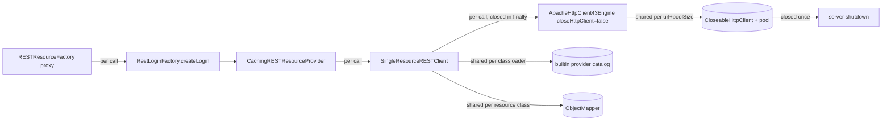

# Outbound REST: stateless client infrastructure once per JVM

<!-- flow-next spec, neutralized: tracker keys, person initials, branch names, fix versions, internal library and integration names removed or generalized. "groupware" is the external platform service from the dev-starter spec; "the bridge" stands for an internal merchandise-management integration; the address lookup is a third-party service. -->

## Goal & Context

Every outbound REST call through the server's `getRestResource(...)` builds a complete RESTEasy client: a new `ResteasyClientBuilderImpl` (2 ServiceLoader lookups), a fresh provider factory with ~30 builtin registrations, a new `ObjectMapper`, and a new connection pool with TCP/TLS handshake. The client is never closed. The groupware notification polling (every 60 s per logged-in Swing user, executed server-side) turns this into permanent CPU load.

Guiding decision (epic): a single REST call stays stateless — token, user context and `CachingRESTResourceProvider` are still created per call. Only the stateless substrate (provider catalog, `ObjectMapper`, connection pool) is built once per JVM and shared.

Affected: server only (single Spring Boot fat-jar JVM). 20 call sites in `erp-impl`: groupware (1 funnel, 23 uses, pool 1000), the bridge (13, pool 1), address lookup (6, pool 1; some with a user-entered test URL). Two repos: the ERP and the shared base REST client library (external, release + parent-POM bump needed).

## Architecture & Data Models



Ownership:
- Per call (unchanged): provider, token/bearer header, `SingleResourceRESTClient`, `ResteasyClient`, engine wrapper.
- Per JVM, `erp-impl`: registry `(endpoint URL, pool size) -> CloseableHttpClient`. Owns pool lifecycle; closed on server shutdown.
- Per JVM, base library: builtin catalog via RESTEasy's own `RegisterBuiltin.getClientInitializedResteasyProviderFactory(TCCL)` cache; `ObjectMapper` cache per resource class.

## Edge Cases & Constraints

- RESTEasy 7.0.0.Final: `ResteasyClientImpl.close()` always calls `httpEngine.close()`. Sharing is therefore done one level lower: the `CloseableHttpClient` is shared, each call wraps it in `new ApacheHttpClient43Engine(shared, false)`, whose `close()` does not close the HttpClient. No custom delegate engine class.
- Builder settings in `RESTClient.getClient()` (pool size, timeouts, hostname verification, proxy) are ignored once a custom engine is set. Already true before for every `CachingRESTResourceProviderBuilder` call. With a shared pool a hung read would pin a pooled connection for the JVM lifetime, so the shared clients set connect 5 min / socket 15 min (the values the base client intended) on their `RequestConfig`.
- Shared pool exposes behaviour that per-call pools masked: contention on small pools, stale keep-alive connections after idle, cookies kept across users, unreleased leases. Each is covered by R4/R5.
- Address-lookup test calls (`forTest(url, user, pw)`) take a user-entered URL; registering them would grow the registry unbounded.
- 401 retry re-runs the whole call (new provider, new client); must keep working.
- One groupware call returns the outbound `Response` (a person image) to the inbound REST bean, which reads the entity after the call returned. A `Response` result is therefore buffered before the per-call client closes; this also releases the pooled connection immediately.
- The ticket's proposed base-library fix (parent factory inside `createResteasyProviderFactory`) does not remove the cost: `RESTClient.config()` passes it through `ResteasyClientBuilderImpl.withConfig(...)`, which creates a new parentless `LocalResteasyProviderFactory` and re-registers everything. The fix must avoid `withConfig`.

## Acceptance Criteria

- **R1:** The `SingleResourceRESTClient` created for a call is closed exactly once on every path: success, exception from the REST call, exception from `getResource`, and each attempt of the 401 retry. Errors: a failure while closing is logged and never replaces the call's own exception or result.
- **R2:** Calls to the same configured endpoint share one connection pool per (endpoint URL, pool size); a second sequential call reuses the open connection (no new TCP/TLS handshake). Errors: connection-test calls with a user-entered URL (address lookup `forTest`, groupware connection test) never use the registry; they own their HttpClient and close it with the call.
- **R3:** Closing a per-call client never closes the shared pool. All shared pools are closed at server shutdown. Errors: pool creation and shutdown are mutually exclusive, so a lookup racing shutdown never leaves a pool the shutdown missed; a lookup after shutdown creates a fresh pool owned by the next lifecycle (one test JVM boots several Spring contexts in sequence).
- **R4:** A shared HttpClient carries no per-user state: cookie management disabled; authentication only via per-call headers. Errors: no error surface beyond R1.
- **R5:** Pool size per endpoint follows the decided values; acquiring a connection is bounded by a checkout timeout, so pool exhaustion fails with an exception instead of blocking indefinitely; idle connections are validated before reuse. Errors: exhausted pool → exception after the timeout; stale connection → revalidated or replaced, not surfaced as `NoHttpResponseException`.
- **R6:** (base library) Building a client no longer creates or populates a fresh provider factory: two clients for the same resource class cause zero additional builtin provider registrations, and the `ObjectMapper` is built once per resource class. Errors: no error surface beyond R7.
- **R7:** (base library) Wire format is unchanged before vs. after R6, proven by a characterization test against a resource using Aspect interfaces and generic `RESTReadListResponse` deserialization (date formats, null handling). Errors: any difference fails the test.
- **R8:** Measured evidence on the real server classpath: baseline cost per client build (split into ServiceLoader, provider catalog, ObjectMapper, TCP/TLS) and the same after the change; heap histogram after N calls shows no growing count of `ResteasyClientImpl` / connection managers; smoke test documented for groupware, the bridge, address lookup. Errors: no error surface beyond measurement.
- **R9:** Calls, paths, payloads and auth flows are unchanged, including the 401 retry with token invalidation. Errors: no error surface beyond R1.

## Early proof point

Step 2 (close defect) proves per-call cleanup on the unchanged engine; every shared-pool change builds on it. Step 3 then proves connection reuse with a local HTTP stub. If reuse via `ApacheHttpClient43Engine(shared, false)` shows lease leaks or stale-connection failures, re-evaluate the sharing level before the base-library bump (step 5).

## Implementation plan

Executed as one no-plan work item. Steps in order; 1, 2 and 4 are independent. Delivery: ERP PR (steps 2+3), base-library PR (step 4), ERP PR (steps 5+6).

**1. Baseline (R8).** N calls through `getRestResource(...)` against a local stub inside the running server fat-jar, not the unit-test classpath. Split via JFR/counters: `ResteasyClientBuilderImpl` ctor + `build()` ServiceLoader, `withConfig` re-registration, `createObjectMapper`, TCP/TLS. Heap histogram before-values (`ResteasyClientImpl`, `PoolingHttpClientConnectionManager`). Harness not committed. Tracker comment only after user OK.

**2. Close defect (R1, R9).** `RESTResourceFactory.handleRestCall` (`:80-97`): holder set by `setAdditionalClientConfigurer`, read and closed in `finally` after the call, then provider close. Close errors logged via the project logger, never mask the call's `InvocationTargetException` (rules 212/213). New `RESTResourceFactoryTest`: close once on success, call exception, `getResource` exception; once per attempt across 401 retry; a throwing `close()` leaves the call's result and its primary exception intact. With today's per-call engine (`closeHttpClient=true`) this already frees the per-call pool.

**3. Shared pool (R2-R5).** Pool sizes and timeouts: see Decision Context.
- `CachingRESTResourceProviderBuilder.build()` (`:99-113`) → `new CachingRESTResourceProvider(url, new ApacheHttpClient43Engine(shared, false))`. Never the `(HttpClient)` ctor: it implies `closeHttpClient=true`.
- Registry `(url, poolSize) -> CloseableHttpClient`. Creation and shutdown share one lock; `closeAll()` closes and clears, a later lookup re-creates (see R3). Mirror the base library's `createHttpEngine` (maxTotal = perRoute = size) plus `disableCookieManagement()`, checkout timeout via `RequestConfig`, `setValidateAfterInactivity`, `evictIdleConnections`.
- Connection tests bypass the registry with an owning, per-call HttpClient: address lookup `forTest(url, user, pw)` and the groupware connection test (shares the groupware login delegate; needs an unshared builder mode).
- Shutdown: close all pools from the server bootstrap's `unload()` (pattern: an existing web-service pool closed there) or a `@PreDestroy` bean.
- Pool constants: groupware login delegate → 50, the bridge → 10, address lookup (uses `DEFAULT_MAX_CONNECTIONS`) → 2. Keep `DEFAULT_MAX_CONNECTIONS` for unshared connection-test paths.
- Audit call sites returning raw `Response`: unreleased lease is permanent with a shared pool. Proxy calls with error status are safe: RESTEasy 7 `ClientInvocation.extractResult` buffers the entity before throwing (that is why the the bridge error extractor sees a `ByteArrayInputStream`).
- Tests with JDK `com.sun.net.httpserver.HttpServer` stub: sequential reuse (one accepted connection), parallel ≤ pool size, exhaustion → exception after timeout, per-call close leaves pool usable; non-401 HTTP error (pool size 1) does not block the next call; two calls with different users see no cookie set by the stub on the other; stub closes an idle keep-alive connection → next call succeeds; concurrent lookup vs. shutdown leaves no open pool. The existing live-bridge IT is `@Disabled`, not a base.

**4. Base library (R6, R7).** Delivered as a patch release, owned by the library maintainer.
- `RESTClient.config(ResteasyClientBuilder)` (`:501-512`): drop `withConfig(...)`; register the configured Jackson provider with `Priorities.USER - 900` on the builder, then both filters. The provider must be a `ResteasyJackson2Provider` subclass: the builtin factory already holds that class, and a second instance of it is silently dropped (RESTEASY002160), losing the resource-specific mapper. `ObjectMapper` cache via `ClassValue`. Builder default factory is already `LocalResteasyProviderFactory(RegisterBuiltin.getClientInitializedResteasyProviderFactory(TCCL))` (RESTEasy 7.0.0.Final `ResteasyClientBuilderImpl:336-353`). Never register on the shared `RegisterBuiltin` factory. Keep `config` overridable.
- `SingleResourceRESTClient.configureJacksonJsonProvider` (`:143-148`): static `ConcurrentHashMap<Class<?>, ObjectMapper>`. First verify `createObjectMapper(Class)` returns a fully configured mapper, not mutated later.
- Characterization test recorded before the change: Aspect interfaces, generic `RESTReadListResponse`, dates, nulls; byte-identical after. Custom providers sort before builtins regardless of priority (`SortedKey`); test confirms Jackson provider still wins.

**5. Bump + end-to-end (R8, R9).** Bump the parent dependency BOM to the patch containing step 4. It also pins RESTEasy: on change, re-check `closeHttpClient=false` behaviour. Repeat step 1; heap histogram after N calls; thread dump under load without `findResource` hotspot; smoke groupware (notifications, calendar), the bridge (health indicator, reader), address lookup (incl. test URL). Scoped verification per rule 052, no ITs.

**6. Docs + tracker.** Decision log under `documentation/decisions/` in the format of the earlier groupware REST client decision (German; rule 225). Tracker corrections (approach, line refs, call-site count) posted at plan time; step 6 adds only result comments, after user OK.

## Boundaries

- No per-user cache of providers or clients (bearer header lives in the client instance; 401 retry would have to invalidate entries).
- No change to call count, paths, payloads, auth flows, or server side.
- No migration to Spring `RestClient` (separate ticket).
- No change to the groupware polling interval.
- The login-only client (default engine, built only on token refresh) stays as is.
- The report client and other clients outside `RESTResourceFactory` are not touched.
- No configurable pool properties; values are constants per login factory.
- Translation story: no UI text expected; close with comment unless a new message key appears.

## Decision Context

- Share the `CloseableHttpClient`, not the engine: RESTEasy closes the engine on every client close; `ApacheHttpClient43Engine(httpClient, false)` is the library's own non-owning mode. Rejected: a non-closing delegate engine (extra class, relies on engine ignoring its `closed` flag).
- Base-library fix skips `withConfig` and registers the Jackson provider (priority `USER - 900`) and the two filters on the builder's default factory, which RESTEasy already derives from its per-classloader cache. Rejected: ticket's parent-factory variant (no effect, see Edge Cases).
- Static registry acceptable: one JVM, one classloader (fat-jar); no redeploy leak.
- Pool sizes (decided 2026-10-13, tech lead): groupware 50, the bridge 10, address lookup 2. Start values; re-tune after step 1/5 measurements. A shared bridge pool of 1 would serialize all bridge calls; groupware 1000 is effectively unbounded.
- Timeouts (decided 2026-10-13, tech lead): checkout 30 s, validate after 2 s inactivity, idle eviction 30 s. Replaces today's 5 min checkout wait for the shared pool.
- Base-library release (decided 2026-10-13, tech lead): patch release so the next ERP patch ships it.
- R8 evidence (decided 2026-10-14, tech lead): measured with a test-classpath harness (client build 1.79 ms → 0.24 ms, call 4.7 ms → 1.3 ms, posted on the tracker) and proven leak-free by `OutboundRestEndToEndTest` (constant connections and evictor threads after 200 calls). No fat-jar/JFR measurement and no heap histogram on a live server; the harness numbers are a lower bound of the saving.

## Quick commands

```bash
mvn -o -nsu -pl :erp-impl test -Dtest='RESTResourceFactoryTest,CachingRESTResourceProviderBuilderTest'
```
